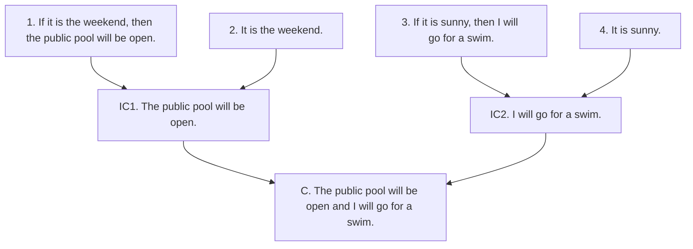

# Standard form

**Standard form is a way of setting out an [argument](argument): each [premise](premise) on its own numbered line, followed by the [conclusion](conclusion).** It strips an argument down to its reasoning so that it can be evaluated.

## Why use it

Setting an argument out in standard form separates the two questions an evaluation asks: do the premises support the conclusion, and are the premises true? In prose these questions are easy to blur.

## Conventions

- Premises are numbered `1.`, `2.`, `3.` ...
- The conclusion comes last, labelled `C.` and introduced by "Therefore".
- Intermediate conclusions are labelled `IC1.`, `IC2.` ...
- A [hidden premise](hidden-premise) you have supplied is marked (HP); a hidden conclusion is marked (HC).
- Each line is a single, complete proposition (which may be compound).

## From prose to standard form

> Phones should be banned from classrooms. They distract students from learning, as anyone who has taught a Year 9 class will tell you.

1. **Find the conclusion.** Look for indicator words, but read for meaning. Here the conclusion comes first: phones should be banned from classrooms.
2. **Find the premises.** Ask what is offered in support. Here: phones distract students from learning.
3. **Separate support for a premise from the main steps.** "As anyone who has taught a Year 9 class will tell you" is offered as backing for the premise, not for the conclusion directly. Set it out as a sub-argument, or note it for your evaluation.
4. **Add hidden premises.** What else must be true? Something linking distraction to banning.
5. **Reword each line** as a complete proposition, using the same wording for the same idea throughout.

```sf
1. Phones distract students from learning in classrooms.
2. Things that distract students from learning should be banned from classrooms. (HP)
C. Therefore, phones should be banned from classrooms.
```

## Mapping a longer argument

An argument with [intermediate conclusions](conclusion) can also be drawn as a map:


*Text alternative:* premises 1 and 2 together support IC1; premises 3 and 4 together support IC2; IC1 and IC2 together support the conclusion.

## Common mistakes

- **Names in premises.** "Jeremy Bentham (1748–1832) states that if an action results in the greatest happiness for the greatest number, then it is morally correct" only reports what Bentham said, so it no longer links to the other premises. Unless the attribution is itself the point, write the principle itself, and attribute it in your evaluation.
- **Shifting wording.** If premise 1 says "donate to charity" and premise 2 says "give money to charity", the link between them may fail. Keep wording consistent; a [dictionary of propositions](translating-symbolising) helps.

## Related concepts
[Argument](argument) · [Premise](premise) · [Conclusion](conclusion) · [Hidden premise](hidden-premise) · [Translating and symbolising propositions](translating-symbolising) · [Deduction](deduction) · [Induction](induction)

## Sources
- Bland, *Reason* (Revised Edition), ch. 1, §1.2 pp. 13–15, §1.3 p. 16; ch. 3, §3.7 pp. 68–69. CC BY-NC 4.0.
- Crimmins, J. E., "Jeremy Bentham", *Stanford Encyclopedia of Philosophy* (rev. 13 Jan 2026) (dates).
- QCAA, *Philosophy & Reason 2025 v1.3* syllabus, p. 7. © State of Queensland (QCAA) 2026, CC BY 4.0.
- Magnus, Button, Trueman and Zach, *forall x: Calgary* (Fall 2025), ch. 1, pp. 3–4. CC BY 4.0.
