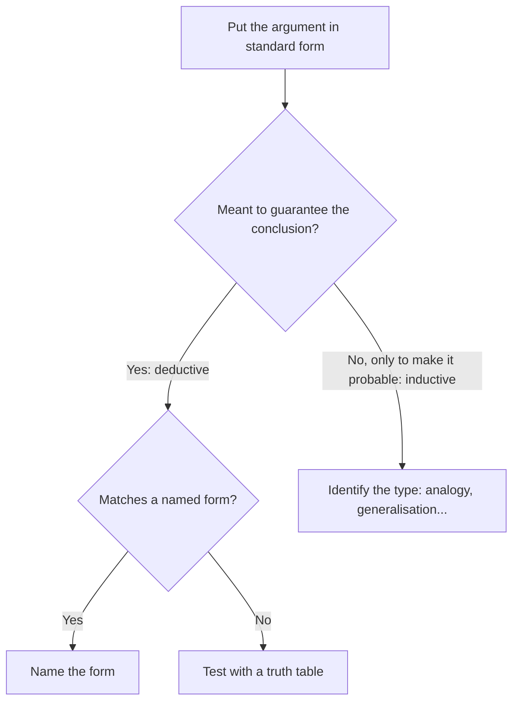

# Classifying arguments

**To classify an argument is to say what kind of argument it is: first whether it is [deductive](deduction) or [inductive](induction), then which type it is.** Classifying comes before evaluating, because it tells you which standards to apply: [validity and soundness](valid) for deductive arguments, [strength](strong-weak) for inductive ones.

## Method

1. **Put the argument in [standard form](standard-form)**, adding any [hidden premises](hidden-premise). Steps 1 and 2 often go together, because which hidden premise to add can depend on whether you read the argument as deductive or inductive.
2. **Deductive or inductive?** Is the conclusion meant to follow *necessarily* or only *probably*? Words such as "must" and "probably" are cues, not proof; read them in context.
3. **If deductive:** [symbolise](translating-symbolising) it. Name the form if it matches one below; otherwise test it with a truth table. (If it matches a formal fallacy, its form does not guarantee its conclusion.)
4. **If inductive:** identify the type, such as [analogy](analogy) or [generalisation](generalisation).



## Named deductive forms

| Form | Symbolic | Valid? |
| --- | --- | --- |
| [Modus ponens](modus-ponens) | `P ⊃ Q, P ∴ Q` | Valid |
| [Modus tollens](modus-tollens) | `P ⊃ Q, ~Q ∴ ~P` | Valid |
| [Hypothetical syllogism](hypothetical-syllogism) | `P ⊃ Q, Q ⊃ R ∴ P ⊃ R` | Valid |
| [Disjunctive syllogism](disjunctive-syllogism) | `P ∨ Q, ~P ∴ Q` | Valid |
| [Constructive dilemma](constructive-dilemma) | `P ⊃ Q, R ⊃ S, P ∨ R ∴ Q ∨ S` | Valid |
| [Affirming the consequent](affirming-the-consequent) | `P ⊃ Q, Q ∴ P` | Invalid (formal fallacy) |
| [Denying the antecedent](denying-the-antecedent) | `P ⊃ Q, ~P ∴ ~Q` | Invalid (formal fallacy) |

## Worked classifications

**1.**

```sf
1. The canteen is either closed or out of pies.
2. The canteen is not closed.
C. Therefore, the canteen is out of pies.
```

Dictionary:

- `C = "The canteen is closed."`
- `O = "The canteen is out of pies."`

```sf
1. C ∨ O
2. ~C
C. O
```

Deductive; disjunctive syllogism; valid.

**2.**

```sf
1. If Mia studies, then she will pass.
2. Mia does not study.
C. Therefore, Mia will not pass.
```

Dictionary:

- `S = "Mia studies."`
- `P = "Mia will pass."`

```sf
1. S ⊃ P
2. ~S
C. ~P
```

Deductive; denying the antecedent; invalid (Mia might pass anyway).

**3.**

```sf
1. Thirty randomly chosen Year 11 students at our school all said they use their phone for homework.
C. Therefore, most Year 11 students at our school probably use their phone for homework.
```

Inductive; a generalisation from a sample. Judge its strength, not its validity: how large and how well chosen is the sample, and does what students *say* they do match what they *do*?

## Hard cases

**No named form.**

```sf
1. If it rains, then the game is off.
2. If the game is off, then training moves to Thursday.
3. Training does not move to Thursday.
C. Therefore, it does not rain.
```

Dictionary:

- `R = "It rains."`
- `G = "The game is off."`
- `T = "Training moves to Thursday."`

```sf
1. R ⊃ G
2. G ⊃ T
3. ~T
C. ~R
```

It combines hypothetical syllogism and modus tollens but matches no single form; a truth table shows it is valid.

**Could be read either way.** Some everyday arguments could be read as deductive (with a hidden premise) or as inductive. Apply the principle of charity: reconstruct the strongest, most reasonable version the arguer could have meant. Say which reading you are using.

**Categorical syllogisms.** Arguments such as "All As are Bs; all Bs are Cs; so all As are Cs" are also deductive. Their validity depends on words such as "all" and "some" rather than on the logical operators, so a truth table cannot test them.

## Related concepts
[Deduction](deduction) · [Induction](induction) · [Deductive and inductive arguments](deductive-vs-inductive) · [Deductively valid and invalid](valid) · [Analogy](analogy) · [Generalisation](generalisation) · [Standard form](standard-form) · [Hidden premise](hidden-premise)

## Sources
- Bland, *Reason* (Revised Edition), ch. 1, §1.4 p. 20; ch. 2, pp. 26–33; ch. 3, pp. 36, 50, 56; ch. 5, p. 89. CC BY-NC 4.0.
- Shanahan, T., "Deductive and Inductive Arguments", *Internet Encyclopedia of Philosophy*, §§2, 4. https://iep.utm.edu/deductive-inductive-arguments/
