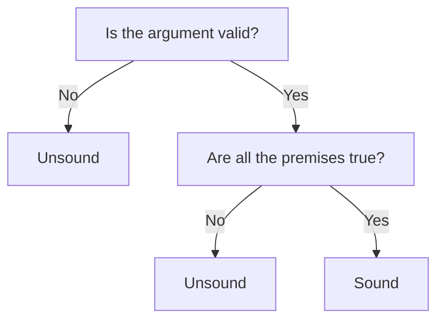

# Sound and unsound

**A deductive argument is sound if and only if it is [valid](valid) and all of its premises are true.** It is unsound if it is invalid, or if at least one premise is false.

## What soundness gives you

A sound argument's conclusion must be true: its premises are true, and validity means true premises cannot lead to a false conclusion. Soundness is the standard a deductive argument must meet to establish its conclusion.

The reverse does not hold: a true conclusion does not make an argument sound. "If Sydney is in Queensland, then Sydney is in Australia. Sydney is in Queensland. Therefore, Sydney is in Australia" is valid and has a true conclusion, but premise 2 is false, so it is unsound.

## Evaluating soundness

Check validity first: an invalid argument is unsound whatever its premises.


*Text alternative:* if the argument is invalid, it is unsound. If it is valid, check every premise: if any premise is false, it is unsound; if all are true, it is sound.

## A worked example

> If the school canteen sells only healthy food, then students will eat more healthily. Our canteen now sells only healthy food. Therefore, students will eat more healthily.

```sf
1. If the school canteen sells only healthy food, then students will eat more healthily.
2. The school canteen sells only healthy food.
C. Therefore, students will eat more healthily.
```

The argument is valid ([modus ponens](modus-ponens)). Premise 2 is easy to check: look at the menu. Premise 1 is contested. In favour: students tend to eat what is available at school. Against: students may bring food from home or buy it elsewhere. Whether premise 1 is true depends on evidence, and the argument is sound only if it is.

## Contested premises

Strictly, soundness requires every premise to be in fact true. In practice, most substantial premises are contested and cannot be established with complete certainty. The working standard is to accept a premise as true for a soundness verdict if it is [plausible](plausible) (it appears to be true) and the weight of evidence supports it. To evaluate a contested premise:

1. State it clearly, and say why it is contested.
2. Present the case for it.
3. Present the case against it.
4. Weigh the two, and make a decisive judgement: the premise is true, or it is not adequately supported.

## All or nothing

Soundness has no degrees. An argument is sound or unsound, never "mostly sound".

The inductive counterpart is an [inductively strong](strong-weak) argument with true premises, which some texts call *cogent*. The term is not used in the syllabus.

## Related concepts
[Deductively valid and invalid](valid) · [Deduction](deduction) · [Premise](premise) · [True and false](true-false) · [Plausible](plausible) · [Credible](credible) · [Inductively strong and weak](strong-weak)

## Sources
- Bland, *Reason* (Revised Edition), ch. 1, §1.4 pp. 18–19; ch. 3, §3.6 pp. 66–68. CC BY-NC 4.0.
- Magnus, Button, Trueman and Zach, *forall x: Calgary* (Fall 2025), ch. 2, §2.4, pp. 14–15. CC BY 4.0.
- Shanahan, T., "Deductive and Inductive Arguments", *Internet Encyclopedia of Philosophy*, §1. https://iep.utm.edu/deductive-inductive-arguments/
