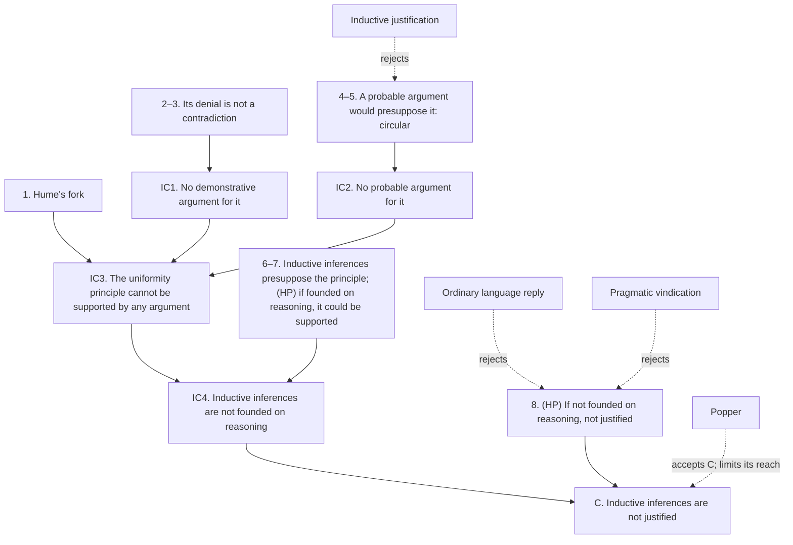

# Hume's problem of induction

**David Hume (1711–1776) argued that our inferences from past experience to the future are not founded on reasoning.** Every such inference seems to assume that nature will continue as it has. Hume argued that this assumption cannot be supported by any argument without arguing in a circle. The challenge of answering him has become known as "the problem of induction".

## Context

Hume first set out the argument in *A Treatise of Human Nature* (1739), Book 1, Part 3, Section 6. He gave a shorter version in Section IV of *An Enquiry Concerning Human Understanding* (1748), the source of most quotations below. The name "problem of induction" is a later label, not Hume's own.

The argument rests on a distinction now called **Hume's fork**. *Relations of ideas*, such as the truths of geometry and arithmetic, can be known by thought alone, and denying one involves a contradiction. *Matters of fact* are different:

> The contrary of every matter of fact is still possible; because it can never imply a contradiction [...]. That the sun will not rise tomorrow is no less intelligible a proposition, and implies no more contradiction than the affirmation, that it will rise.
>
> — Hume, *Enquiry*, §IV, Part 1

In other words: you can work out that three times five is half of thirty without looking at the world. Whether the sun will rise tomorrow is something only experience can tell you.

## Hume's question

Hume's example is bread:

> The bread, which I formerly eat, nourished me; that is, a body of such sensible qualities was, at that time, endued with such secret powers: but does it follow, that other bread must also nourish me at another time, and that like sensible qualities must always be attended with like secret powers? The consequence seems nowise necessary.
>
> — Hume, *Enquiry*, §IV, Part 2

In other words: bread that looked and felt like this has nourished me before, and I expect the next piece to nourish me too. But what reasoning takes me from the first claim to the second?

Hume is not doubting that we *make* such inferences, or that we should go on making them: "As an agent, I am quite satisfied in the point; but as a philosopher [...] I want to learn the foundation of this inference" (§IV, Part 2).

## The uniformity of nature

Hume's answer is that every inference from experience relies on an assumption:

> all our experimental conclusions proceed upon the supposition that the future will be conformable to the past.
>
> — Hume, *Enquiry*, §IV, Part 2

In the *Treatise*, the assumption is that "instances, of which we have had no experience, must resemble those, of which we have had experience, and that the course of nature continues always uniformly the same" (*Treatise* 1.3.6). This is now called the **uniformity principle**, or the principle of the uniformity of nature.

The principle works as a [hidden premise](hidden-premise). As stated, the bread argument is inductive:

```sf
1. All the bread of this kind that I have eaten has nourished me.
C. Therefore, the next bread of this kind that I eat will nourish me.
```

Add the principle, applied to this case, and the argument becomes deductive (a [modus ponens](modus-ponens)):

```sf
1. All the bread of this kind that I have eaten has nourished me.
2. If all the bread of this kind that I have eaten has nourished me, then the next bread of this kind that I eat will nourish me. (HP)
C. Therefore, the next bread of this kind that I eat will nourish me.
```

The gap between past and future has not gone away. It has moved into premise 2, which is only as good as the principle behind it. Hume argues that the principle itself cannot be supported.

The principle is also hard to state well. The future resembles the past only in some respects: a child who has always been shorter than the door frame will not always be. Critics have complained that the principle is vague.

## The argument

Hume considers the two kinds of reasoning in turn.

**Not demonstrative.** Demonstrative reasoning concerns relations of ideas: on one influential reading, it is *a priori* reasoning, as in mathematics. But "it implies no contradiction that the course of nature may change, and that an object, seemingly like those which we have experienced, may be attended with different or contrary effects" (§IV, Part 2). You can coherently imagine bread that poisons, or snow that tastes of salt. So no demonstrative argument can establish the principle.

**Not probable.** Probable reasoning concerns matters of fact and rests on experience. But all reasoning from experience already assumes the principle. So to support the principle this way

> must be evidently going in a circle, and taking that for granted, which is the very point in question.
>
> — Hume, *Enquiry*, §IV, Part 2

In other words: "the future has resembled the past in the past, so it will in future" uses the very principle it is meant to support (compare [begging the question](begging-the-question)).

## Standard form

```sf
1. If the uniformity principle can be supported by some argument, then it can be supported by a demonstrative argument or by a probable argument. (Hume's fork)
2. If it can be supported by a demonstrative argument, then its denial is a contradiction.
3. Its denial is not a contradiction.
IC1. Therefore, it cannot be supported by a demonstrative argument. (2, 3)
4. A probable argument for the uniformity principle would presuppose the uniformity principle.
5. If a probable argument for it would presuppose it, then it cannot be supported by a probable argument. (No argument may presuppose what it is meant to support.)
IC2. Therefore, it cannot be supported by a probable argument. (4, 5)
IC3. Therefore, it cannot be supported by any argument. (1, IC1, IC2)
6. Inductive inferences presuppose the uniformity principle.
7. If inductive inferences presuppose the uniformity principle and are founded on reasoning, then the uniformity principle can be supported by some argument. (HP)
IC4. Therefore, inductive inferences are not founded on reasoning. (6, 7, IC3)
8. If inductive inferences are not founded on reasoning, then they are not justified. (HP)
C. Therefore, inductive inferences are not justified. (8, IC4)
```

Dictionary:

- `A = "The uniformity principle can be supported by some argument."`
- `D = "The uniformity principle can be supported by a demonstrative argument."`
- `P = "The uniformity principle can be supported by a probable argument."`
- `N = "The denial of the uniformity principle is a contradiction."`
- `R = "A probable argument for the uniformity principle would presuppose it."`
- `U = "Inductive inferences presuppose the uniformity principle."`
- `J = "Inductive inferences are founded on reasoning."`
- `K = "Inductive inferences are justified."`

```sf
1. A ⊃ (D ∨ P)
2. D ⊃ N
3. ~N
IC1. ~D
4. R
5. R ⊃ ~P
IC2. ~P
IC3. ~A
6. U
7. (U & J) ⊃ A
IC4. ~J
8. ~J ⊃ ~K
C. ~K
```

**Classification.** Although it is about induction, Hume's argument is deductive. IC1 follows by [modus tollens](modus-tollens) and IC2 by modus ponens. IC3 follows because both options in premise 1 are ruled out, and IC4 because premise 6 holds but the principle cannot be supported. C follows by modus ponens. A truth table confirms that the argument is valid, so anyone who rejects its conclusion must reject a premise.

**Two points of interpretation.** First, Hume's "demonstrative" is often read as "deductive". On that reading premise 2 would be false, because a deductive argument can have a conclusion that is not necessary if one of its premises is not necessary. The reading used here takes "demonstrative" as *a priori*. Second, some scholars read Hume as describing how the mind works, not as concluding that induction is unjustified. On that reading, his argument ends at IC4 and has no premise 8. The argument has, however, mostly been read as an argument for scepticism about induction.

## Argument map

<!-- diagram: argument-map, branch: reason -->

*Text alternative:* Premises 2–3 support IC1 and premises 4–5 support IC2. With Hume's fork, these support IC3. IC3 with premises 6–7 supports IC4, and IC4 with premise 8 supports the conclusion. The inductive justification of induction rejects premise 5 (that circularity rules out support). The ordinary language reply and the pragmatic vindication reject premise 8. Popper accepts the conclusion but denies that science needs inductive inference.

## Hume's own response: custom

Hume does not conclude that we should stop reasoning from experience. Instead he explains why we do it. After two things have been constantly joined, the mind is simply led by habit to expect the one when it meets the other:

> Custom, then, is the great guide of human life. It is that principle alone which renders our experience useful to us, and makes us expect, for the future, a similar train of events with those which have appeared in the past.
>
> — Hume, *Enquiry*, §V, Part 1

In other words: inductive inference is a habit of the mind, a kind of natural instinct, not the result of reasoning. Hume titles this section a "sceptical solution". It explains the inference without justifying it by argument.

Bertrand Russell (1872–1970) gave a well-known illustration in *The Problems of Philosophy* (1912). A chicken fed by the same man every day of its life comes to expect food whenever he appears, until the day he kills it instead. Russell distinguished two things: that past regularities *cause* us to expect them to continue, and whether that expectation has any reasonable ground.

## Objections and replies

**1. Induction has worked so far.** Inductive reasoning has a strong track record, so it will probably go on working. Hume's reply is that this argument is itself inductive, so it assumes what it is meant to show. Defenders reject premise 5: not every circle is vicious. An argument that relies on a *rule* to show that the rule is reliable differs from one that assumes its conclusion as a *premise*, and even deduction cannot be justified to someone who refuses to use modus ponens.
*Reply:* the same method lets "counterinduction" (expecting the future to be *unlike* the past) support itself. So the argument cannot persuade a sceptic, or show that induction rather than its rivals is reliable.
*Response:* defenders concede this, but say the argument was never meant to do so much. It still adds something: a check that our inductive beliefs are consistent with each other.

**2. Induction is what being reasonable means.** P. F. Strawson (1919–2006) argued that asking whether induction *in general* is justified is confused. We judge a particular inductive inference by inductive standards, such as many favourable cases in varied circumstances. Questioning those standards, he held, is like questioning whether we should match our confidence to the strength of the evidence. In Strawson's words, "Doing this is what 'being reasonable' means in such a context."
*Reply:* meeting our standards is not enough. What Hume questions is whether we have reason to think an inductive conclusion is *likely to be true*. Strawson himself accepts that whether induction will go on succeeding is a separate, factual question.

**3. Induction is the best bet.** Hans Reichenbach (1891–1953) accepted Hume's argument, but offered a weaker "vindication". If there is a stable pattern to be found, following induction will eventually find it; if there is none, no method will succeed. He compared this to a doctor who says, "I do not know whether an operation will save the man, but if there is any remedy, it is an operation."
*Reply:* many other methods would also find such a pattern in the long run, so induction is not shown to be the only one that works. And the vindication concerns the very long run, while we rely on induction in the short run.

**4. Science does not need induction.** Karl Popper (1902–1994) regarded the problem as unsolvable, but argued that science does not rely on inductive inference at all. On his view, science proceeds by bold conjectures and attempts to refute them, using modus tollens, which is deductive. See the [hypothetico-deductive method](hypothetico-deductive) and [the problem of induction and scientific knowledge](induction-in-science).
*Reply:* at any time many hypotheses remain unrefuted, and scientists still judge one better supported than another. Popper's notion of "corroboration" seems to bring back something more than deduction.

## How to evaluate it

1. **Classify it.** The argument is deductive, so ask whether it is valid and sound.
2. **Check validity.** It is valid, so the debate is about the premises and about where the argument ends.
3. **Test the premises.**
   - Premises 2–3: could some truths about the world be known *a priori* after all? Or could *a priori* reasoning show that an inductive conclusion is probable, even if not certain?
   - Premise 5: is every circular argument for the principle vicious? (Objection 1.)
   - Premise 8: must justification come from a chain of reasoning at all? (Objections 2 and 3.)
4. **Ask where the argument ends.** Is Hume concluding that induction is unjustified (C), or only that it is a habit of mind rather than a process of reasoning (IC4)?

The Explorer does not give a verdict. Many solutions have been proposed, and many philosophers accept that the problem cannot be solved.

## Questions it raises

- If no argument shows that the future will resemble the past, in what sense is scientific knowledge *knowledge*?
- Scientists describe theories as well supported rather than proven. How should the public judge scientific claims, given that inductive conclusions are fallible?

## Related concepts
[Induction](induction) · [Inductively strong and weak](strong-weak) · [Generalisation](generalisation) · [Deductive and inductive arguments](deductive-vs-inductive) · [Limitations of deduction](limits-of-deduction) · [Hidden premise](hidden-premise) · [Begging the question](begging-the-question) · [Modus tollens](modus-tollens) · [Modus ponens](modus-ponens) · [Hypothetico-deductive method](hypothetico-deductive) · [The problem of induction and scientific knowledge](induction-in-science)

## Sources
- Hume, D., *An Enquiry Concerning Human Understanding* (1748), §IV Parts 1–2, §V Part 1. Standard Ebooks edition, based on the Selby-Bigge text of the posthumous 1777 edition. Public domain. https://standardebooks.org/ebooks/david-hume/an-enquiry-concerning-human-understanding
- Hume, D., *A Treatise of Human Nature* (1739), 1.3.6. Standard Ebooks edition. Public domain.
- Henderson, L., "The Problem of Induction", *Stanford Encyclopedia of Philosophy* (rev. 22 Nov 2022), §§1–3, 4.1–4.2, 5.2–5.3, 6 (including the vagueness of the uniformity principle, §4.2). https://plato.stanford.edu/entries/induction-problem/
- Strawson, P. F., *Introduction to Logical Theory* (1952), pp. 256–57, as quoted in Henderson §5.2.
- Reichenbach, H., *Experience and Prediction* (1938; 2006 edition, p. 349), as quoted in Henderson §5.3.
- Russell, B., *The Problems of Philosophy* (1912), ch. VI, "On Induction" (paraphrased).
- Bland, *Reason* (Revised Edition), ch. 5, §5.1 pp. 90–91. CC BY-NC 4.0.
- Dates: *Stanford Encyclopedia of Philosophy* entries on Hume, Russell, Strawson, Reichenbach and Popper.
