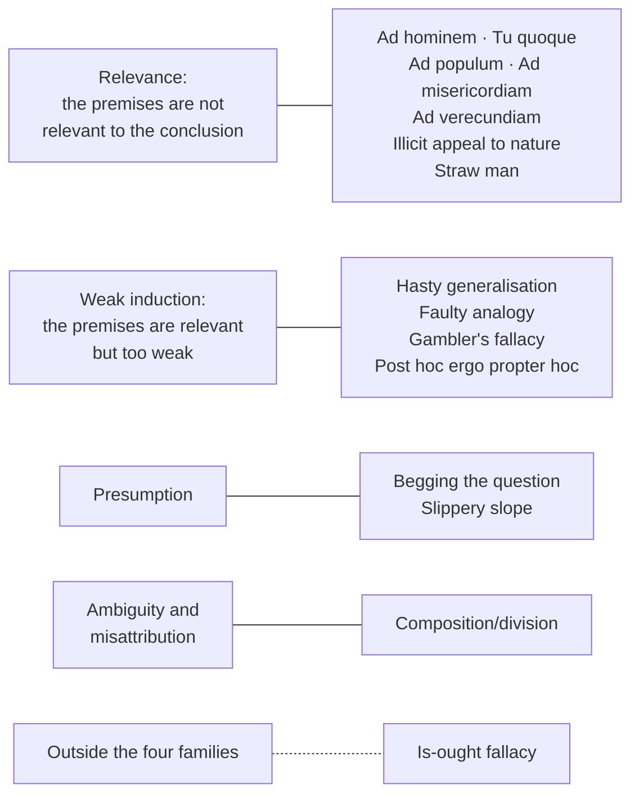

# Informal fallacies

**A fallacy is a flaw in reasoning that undermines an argument. An informal fallacy is a mistake in an argument's content or expression; it cannot be identified from logical form alone.** Informal fallacies can occur in both deductive and inductive arguments.

## Formal and informal

A *formal* fallacy is an invalid argument form, such as [affirming the consequent](affirming-the-consequent) or [denying the antecedent](denying-the-antecedent). It can be spotted from the form alone. An *informal* fallacy usually cannot be spotted that way. These two arguments have the same form:

```sf
1. My GP says this rash will clear up without treatment.
C. Therefore, this rash will probably clear up without treatment.
```

```sf
1. A famous footballer says this supplement prevents colds.
C. Therefore, this supplement probably prevents colds.
```

Symbols cannot tell them apart. The difference is in the content: a GP is a relevant authority on rashes, but a footballer is not an authority on medicine. The second commits [ad verecundiam](ad-verecundiam).

An argument can be [valid](valid) and still commit an informal fallacy. Arguments that [beg the question](begging-the-question) are often valid.

## Families of informal fallacies

Fallacies can be grouped by what goes wrong. One way to group them is shown below; researchers disagree about the best grouping.



*A map of the informal fallacies covered here, grouped into four families. The is-ought fallacy is shown apart.*

The is-ought fallacy does not sit neatly in these families. It draws a normative conclusion from purely descriptive premises: see [descriptive and normative claims](descriptive-normative).

| Family | Entries |
| --- | --- |
| Relevance | [Ad hominem (abusive and circumstantial)](ad-hominem) · [Tu quoque (illicit appeal to hypocrisy)](tu-quoque) · [Ad populum (illicit appeal to popular opinion/bandwagon fallacy)](ad-populum) · [Ad misericordiam (illicit appeal to emotion)](ad-misericordiam) · [Ad verecundiam (appeal to the wrong authority)](ad-verecundiam) · [Illicit appeal to nature](appeal-to-nature) · [Straw man](straw-man) |
| Weak induction | [Hasty generalisation](hasty-generalisation) · [Faulty analogy](faulty-analogy) · [Gambler's fallacy](gamblers-fallacy) · [Post hoc ergo propter hoc (false cause)](post-hoc) |
| Presumption | [Begging the question](begging-the-question) · [Slippery slope](slippery-slope) |
| Ambiguity and misattribution | [Composition/division](composition-division) |
| Outside the four families | [Is-ought fallacy](is-ought) |

## Identifying fallacies fairly

- **Judge the reasoning, not the conclusion.** A true conclusion can rest on poor reasoning, and careful reasoning can reach a false one. Calling an argument fallacious says nothing about whether its conclusion is true.
- **Read charitably first.** Ask whether a shaky argument could reasonably be strengthened before condemning it.
- **Expect judgement calls.** Inductive arguments sit on a spectrum of [strength](strong-weak). Deciding whether evidence is "too thin" is often a matter of degree.
- **Justify the charge.** Naming a fallacy is not enough; explain what goes wrong in this argument. You do not have to name a fallacy to evaluate an argument well.

## Related concepts
[Argument](argument) · [Deductively valid and invalid](valid) · [Inductively strong and weak](strong-weak) · [Affirming the consequent](affirming-the-consequent) · [Denying the antecedent](denying-the-antecedent) · [Descriptive and normative claims](descriptive-normative) · [Cognitive bias](cognitive-bias)

## Sources
- Bland, *Reason* (Revised Edition), ch. 1 p. 14; §3.7 p. 68; ch. 4 pp. 70–86. CC BY-NC 4.0.
- Hansen, H., "Fallacies", *Stanford Encyclopedia of Philosophy* (rev. 30 Aug 2024), introduction. https://plato.stanford.edu/entries/fallacies/
- Dowden, B., "Fallacies", *Internet Encyclopedia of Philosophy*. https://iep.utm.edu/fallacy/
