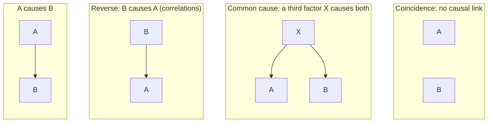

# Post hoc ergo propter hoc (false cause)

*"After this, therefore because of this"*

**The false cause fallacy concludes that one thing caused another on insufficient grounds.** *Post hoc ergo propter hoc* is the version based on order in time. B happened after A, so A must have caused B. A closely related version is *cum hoc ergo propter hoc* ("with this, therefore because of this"). It is based on correlation: A and B tend to occur together, so one must cause the other. Both are commonly called false cause, and often just "post hoc". They are [informal fallacies](informal-fallacy) of weak induction: the premises are relevant, but too weak to support the conclusion.

## The pattern

```sf
1. B happened after A.
C. Therefore, A caused B.
```

The correlation version:

```sf
1. A and B tend to occur together.
C. Therefore, A causes B.
```

Watch for phrases such as "ever since", "every time I..." and "after we started X, Y improved".

## Other explanations to rule out

A sequence or a correlation fits several explanations, including these four.



*Four possible explanations of a link between A and B. The arrows show the direction of cause.*

Reverse causation applies to correlations; a later event cannot ordinarily cause an earlier one. A causal conclusion is only as strong as the case for "A causes B" over the alternatives. B might also have happened anyway, whether or not A occurred.

## Examples

At the school sports carnival, a runner says, "I wore my lucky socks and won my race. I'm wearing them every carnival now."

```sf
1. I won my race after wearing my lucky socks.
C. Therefore, wearing my lucky socks helped me win.
```

This is *post hoc*. Nothing links the socks to the result except the order in time.

A principal reports, "We installed air conditioning in the senior classrooms this year, and Year 12 results improved. The air conditioning worked."

```sf
1. Year 12 results improved after air conditioning was installed.
C. Therefore, the air conditioning improved Year 12 results.
```

It might have. But this year's cohort, teachers and exams are also different, and results vary from year to year anyway. Without considering those, the sequence alone is weak support.

A beach kiosk owner notices that on days with high ice-cream sales, the lifeguards also treat more sunburn. "Ice cream must cause sunburn," she jokes.

```sf
1. Ice-cream sales and sunburn cases rise and fall together.
C. Therefore, eating ice cream causes sunburn.
```

This is *cum hoc*. Hot, sunny weather is a likely common cause: it increases both.

## When it is not fallacious

Sequence and correlation can be genuine evidence of cause; they are often where an inquiry into causes begins. Reasoning from them is not fallacious when the other explanations have been considered and shown to be unlikely. Controlled comparisons, repeated testing and a known mechanism all help to do this. The conclusion is then [inductively strong](strong-weak), not certain. See [cause](cause) and the [hypothetico-deductive method](hypothetico-deductive).

## Related concepts
[Cause](cause) · [Induction](induction) · [Hasty generalisation](hasty-generalisation) · [Slippery slope](slippery-slope) · [Hypothetico-deductive method](hypothetico-deductive) · [Inductively strong and weak](strong-weak) · [Informal fallacies](informal-fallacy)

## Sources
- Bland, *Reason* (Revised Edition), ch. 4, §4.2 p. 76; p. 80 (incl. fn. 19). CC BY-NC 4.0.
- Hansen, H., "Fallacies", *Stanford Encyclopedia of Philosophy* (rev. 30 Aug 2024), §1 (item 7). https://plato.stanford.edu/entries/fallacies/
- Dowden, B., "Fallacies", *Internet Encyclopedia of Philosophy*, "False Cause", "Post Hoc", "Cum Hoc, Ergo Propter Hoc". https://iep.utm.edu/fallacy/
