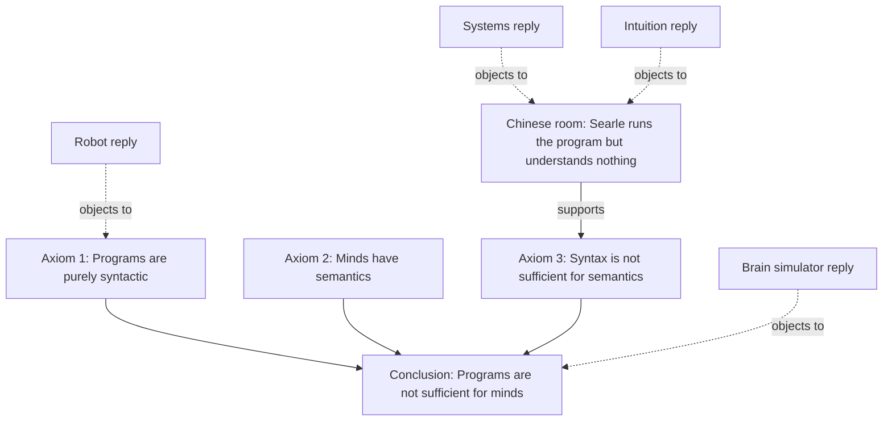

# Searle's Chinese room argument

**The Chinese room is a thought experiment by John Searle (1932–2025). It argues that running a computer program can never, by itself, be enough for understanding.** A person could follow a program for answering questions in Chinese perfectly, and still not understand a word of Chinese.

*Syllabus note:* schools study at least two of the four philosophy of mind arguments (Descartes, Jackson, Chalmers, Searle).

## Context

Searle published the argument in "Minds, Brains, and Programs" (1980). He distinguished two views of [artificial intelligence (AI)](artificial-intelligence):

- **Weak AI:** computers are a powerful tool for studying the mind, for example for testing hypotheses about it.
- **Strong AI:** "the appropriately programmed computer really is a mind" (Searle 1980, p. 417). On this view, a computer running the right program literally understands.

Searle attacks only strong AI. His target is *intentionality*, the feature of mental states of being about something; understanding a story is his main example. His example was the work of Roger Schank's group at Yale, whose programs answered questions about simple stories. The argument also challenges the Turing test. Alan Turing (1912–1954) proposed in 1950 that if a computer can pass for a human in conversation, it should count as intelligent.

## The thought experiment

Searle imagines himself locked in a room. He knows no Chinese: "To me, Chinese writing is just so many meaningless squiggles" (p. 418). He is given batches of Chinese writing and a rule book in English. The rules tell him which Chinese symbols to send out in response to the symbols that come in, identifying symbols only by their shapes.

Unknown to him, the people outside call the incoming symbols "questions", the outgoing ones "answers", and the rule book "the program". Searle becomes so good at following the rules that his answers are indistinguishable from a native speaker's. Yet, he says, "I can have any formal program you like, but I still understand nothing" (p. 418).

In other words: Searle is doing exactly what a computer does, manipulating symbols by rule. If doing that is not enough for him to understand Chinese, it is not enough for a computer either.

## Standard form

### Version 1: the thought experiment (1980)

Dictionary: `S = "Strong AI is true."` `U = "Searle in the room understands Chinese."`

1. If strong AI is true, then any system that runs the right program for Chinese understands Chinese.
2. Searle in the room runs the right program for Chinese.
3. So, if strong AI is true, Searle in the room understands Chinese. `S ⊃ U` (from 1 and 2)
4. Searle in the room does not understand Chinese. `~U`
C. Therefore, strong AI is false. `~S`

Steps 3, 4 and C form [modus tollens](modus-tollens), so this version is deductively [valid](valid). (This reconstruction follows Cole's in the *Stanford Encyclopedia of Philosophy*.)

### Version 2: syntax and semantics (1990)

Searle later stated the argument as three "axioms" and a conclusion:

> Axiom 1. Computer programs are formal (syntactic).
> Axiom 2. Human minds have mental contents (semantics).
> Axiom 3. Syntax by itself is neither constitutive of nor sufficient for semantics.
> Conclusion 1. Programs are neither constitutive of nor sufficient for minds.
>
> — Searle, "Is the Brain's Mind a Computer Program?", *Scientific American* 262 (1990), p. 27

*Syntax* is the form of symbols and the rules for combining them; *semantics* is their meaning. The Chinese room is offered as support for Axiom 3.

To make the inference to "not sufficient" explicit, you need two hidden premises:

- (HP1) If programs are purely syntactic and syntax is not sufficient for semantics, then programs are not sufficient for semantics.
- (HP2) If minds have semantics and programs are not sufficient for semantics, then programs are not sufficient for minds.

Dictionary: `A = "Programs are purely syntactic."` `B = "Minds have semantics."` `D = "Syntax is sufficient for semantics."` `E = "Programs are sufficient for semantics."` `M = "Programs are sufficient for minds."`

`A, B, ~D, (A & ~D) ⊃ ~E, (B & ~E) ⊃ ~M ∴ ~M`

The "neither constitutive of" half of the conclusion needs parallel premises about constitution.

Notice the precise claim. Searle argues that running a program is not a [sufficient condition](necessary-sufficient) for a mind. He is more cautious about *necessary* conditions: he says no reason has been given to think that running a program is necessary for understanding, but admits he has not shown that it plays no part (1980, p. 418). He also does not argue that no machine could think. He says brains are machines that think, and that an artificial system with the brain's causal powers could think too.

## Argument map

<!-- diagram: argument-map, branch: philosophy -->

*Text alternative:* Axioms 1, 2 and 3 together support the conclusion. The Chinese room supports Axiom 3. The systems reply and the intuition reply object to what the thought experiment shows. The robot reply denies that an embodied system is purely syntactic (Axiom 1). The brain simulator reply claims that a program of the right kind would be sufficient (the conclusion).

## Objections and replies

Searle answered the main objections in the 1980 paper.

**The systems reply.** Searle is only one part of a larger system that includes the rule book, the paper and the data. The person does not understand Chinese, but the whole system does.
*Searle's reply:* "let the individual internalize all of these elements of the system" (p. 419). Searle memorises the rules and works in his head, even outdoors. Now he *is* the whole system, and he still understands nothing. He adds that the reply [begs the question](begging-the-question), since it simply insists the system understands.
*Response:* some critics (for example David Cole and Ned Block) argue that internalising the program would not make Searle identical with the system. It might instead produce a second, Chinese-understanding mind in the same head. This is often called the *virtual mind reply*.

**The robot reply.** Put the computer in a robot with cameras and motors, so its symbols are connected to the world. Then it would understand.
*Searle's reply:* this concedes that symbol manipulation alone is not enough. And put Searle inside the robot: the camera's signals arrive as more Chinese symbols, and adding perception and movement "adds nothing by way of understanding" (p. 420).
*Response:* many philosophers of language hold that words get their meaning from causal links to the world. On that view, a robot's connections could supply meaning that the sealed room lacks.

**The brain simulator reply.** Suppose the program simulates the actual firing of neurons in a Chinese speaker's brain. Surely that system would understand.
*Searle's reply:* imagine the man operating water pipes and valves that copy the pattern of the neurons. He still does not understand. The simulation copies the brain's formal structure but not its causal powers: "it is simulating the wrong things about the brain" (p. 421).

**The intuition reply.** The argument depends on our intuition that the man does not understand. Daniel Dennett called the thought experiment an "intuition pump". Critics such as Ned Block argue that intuitions about a case this strange can be mistaken, and may need revising as science develops.

**The other minds reply.** We judge that other people understand only by their behaviour, so we should judge computers the same way.
*Searle's reply:* the question is not how we *know* that others have mental states, but what it is that we attribute to them when we do.

## How to evaluate it

1. **Classify it.** Both versions are deductive arguments, so ask whether they are valid and sound.
2. **Check validity.** Version 1 is modus tollens, so it is valid. Version 2 is valid once the hidden premises are added. Most of the replies above therefore dispute a premise or what the thought experiment shows, rather than the logic.
3. **Test each premise.**
   - Premise 1 (version 1): does strong AI really claim that *whoever runs* the program understands, or only that understanding is created somewhere? The virtual mind reply targets this.
   - Premise 4 (version 1): Searle says it is obvious that he understands nothing. The intuition reply questions whether this is reliable.
   - Premise 2 (version 1): the robot and brain simulator replies accept that the room does not understand, but deny that it covers every relevant kind of system. Does the room generalise to *all* programs?
   - Axioms 1 and 3 (version 2): is a program running in a body, connected to the world, still *purely* syntactic? And is Axiom 3 something the room shows, or something it assumes?
4. **Separate what is claimed from what is not.** The argument concerns sufficiency. It leaves open whether some non-biological system could think, if it had the right causal powers.

The Explorer does not give a verdict. Philosophers remain divided on whether the argument succeeds.

## The Chinese room and current AI

Searle's target was a program built around hand-written "scripts" for short stories. Large language models (LLMs) are instead trained on huge amounts of text. Does this make a difference to the argument?

- **Doubts about understanding:** linguists Emily Bender and Alexander Koller argue that "a system trained only on form has a priori no way to learn meaning" (2020). This parallels Searle's Axiom 3 for systems trained on text alone. Unlike Searle, though, they allow that grounding in the world might supply meaning.
- **Claims of understanding:** some, including David Cole in the *Stanford Encyclopedia*, argue that when systems match human experts across many tasks, denying that they understand anything becomes hard to defend. Others suggest LLMs understand in a partial sense. Cole also notes that current systems do not yet settle the question.

Each side has to say what understanding is, and that question is exactly what the Chinese room puts in dispute.

## Related concepts
[Artificial intelligence](artificial-intelligence) · [Mind](mind) · [Consciousness](consciousness) · [Physicalism](physicalism) · [Modus tollens](modus-tollens) · [Necessary and sufficient conditions](necessary-sufficient) · [Begging the question](begging-the-question) · [Dualism](dualism) · [Descartes's mind–body dualism](descartes-dualism) · [Jackson's epiphenomenal qualia](jackson-qualia) · [Chalmers's philosophical zombie](chalmers-zombie)

## Sources
- Searle, J. R. (1980), "Minds, brains, and programs", *Behavioral and Brain Sciences* 3(3): 417–457. Quotations from pp. 417–421.
- Searle, J. R. (1990), "Is the Brain's Mind a Computer Program?", *Scientific American* 262, no. 1 (January): 26–31. Axioms on p. 27.
- Cole, D., "The Chinese Room Argument", *Stanford Encyclopedia of Philosophy* (rev. 23 Oct 2024).
- Hodges, A., "Alan Turing", *Stanford Encyclopedia of Philosophy*.
- Bender, E. M. & Koller, A. (2020), "Climbing towards NLU: On Meaning, Form, and Understanding in the Age of Data", *Proceedings of ACL 2020*, pp. 5185–5198.
